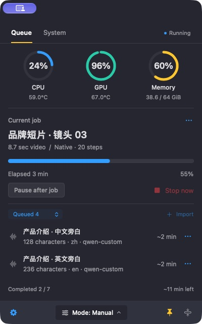
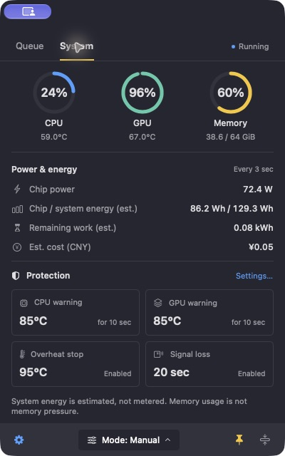

# IdleDock

**Local AI, in order.**

[简体中文](README.zh-CN.md) · [Install](docs/INSTALL.md) · [Agent guide](docs/AGENT_GUIDE.md) · [Provider API](docs/PROVIDERS.md) · [Linux / DGX Spark (experimental)](docs/LINUX.md)

A local, serial job queue for resource-intensive work on Apple Silicon Macs. Queue H3 video, batch speech synthesis, or your own local program; control execution from a native menu bar widget or a JSON CLI.

IdleDock began as **Queue Mac H3** and was briefly described as Local Compute Queue. The legacy `H3 Queue.app` filename, internal identifiers, and `H3_QUEUE_*` settings remain compatible with earlier installations; the displayed app name is IdleDock.

## Screenshots

| Mixed H3 / TTS queue | System monitoring and protection |
| --- | --- |
|  |  |

Captured from the implemented native app in read-only preview mode. Task names, progress, and measurements are illustrative; queue controls are disabled in this preview. [Screenshot fixture and capture notes](docs/images/README.md).

## What it does

- Runs one job at a time across providers, with a cooperative deployment lock.
- Supports manual, scheduled, and idle-only execution. Adding a job never changes the execution mode.
- Stores jobs, attempts, cache fingerprints, and measurements in SQLite; stores output files separately.
- Monitors temperature, memory, swap, disk space, and runtime; protection stops require an explicit restart.
- Keeps every attempt's logs and supports retries, cancellation, priorities, and atomic batch import.
- Provides a floating SwiftUI/AppKit widget with video preview, audio playback, and system metrics. Supports 11 UI languages: English, Simplified/Traditional Chinese, Japanese, Korean, Spanish, French, German, Russian, Brazilian Portuguese and Italian, with automatic system-language selection and instant switching.

No web server, cloud account, Redis, Docker, or Node.js is required. The queue uses Python's standard library plus `psutil`; models run in their own environments.

## Experimental Linux worker

A headless Linux CLI/worker and owned local ComfyUI adapter are available for testing. Run one queue per Spark; use SSH from the Mac to view/control it. Manual and scheduled (`--no-idle`) modes retain resource protection. Linux desktop idle detection, remote SwiftUI and multi-host balancing are not implemented. **No DGX Spark hardware or real CUDA workflow validation yet.** [Setup, sensor requirements and contribution guide](docs/LINUX.md).

## Current scope

| Integration | Available here | Required separately |
| --- | --- | --- |
| Command provider | Versioned JSON/argv protocol and a runnable CPU example | Your installed program; declare its dependencies and resources |
| TTS | Adapters for `mlx-audio`, `mlx-audio-plus`, `indextts`, and `auk`; multiple profiles | Compatible runtime, local weights, and a profile configuration |
| H3 | Legacy text-video and native audio-avatar adapters | Existing deployment wrapper/entrypoints; patched native engine for audio-avatar |

**This repository does not include models, model environments, or the original H3 deployment.** Read the [deployment contract](docs/DEPLOYMENT.md) before connecting one. Adapter tests use fake runtimes; they do not certify every model/version or the quality of generated speech/video.

All providers currently run serially, including CPU providers. The lock cannot constrain programs launched outside the shared protocol. There is no automatic TTS → H3 workflow graph, model downloader, or persistent model pool.

## Start without a model

Use an Apple Silicon Mac with macOS 14+, Python 3.10+, and Command Line Tools for the native app. From this checkout:

```sh
git clone https://github.com/RockHammer1947/IdleDock.git
cd IdleDock
python3 -m venv .venv
.venv/bin/python -m pip install -r requirements.txt
export H3_QUEUE_PYTHON="$PWD/.venv/bin/python"
./queue --help
.venv/bin/python -m unittest discover -s tests -p 'test_providers.py' -v
```

These tests use temporary databases and tiny fake outputs, without downloading or running a model. Continue with the [isolated demo](docs/INSTALL.md#isolated-demo) to import your first job. Actual queue execution also requires working temperature telemetry; video work needs FFmpeg/ffprobe.

For an already configured deployment:

```sh
./queue configure --deployment /absolute/local-model-deployment
./queue doctor
./setup.command
```

Setup builds a locally ad-hoc-signed app and starts the background worker. A new queue is paused; an existing queue keeps its current mode. The app is tied to this checkout's paths and is not a notarized, portable binary release.

## Daily use

Choose **Settings (gear) → Language / 语言** for any of the 11 UI languages or Follow System. The choice is remembered and does not affect queue execution or TTS synthesis language. [Localization details](docs/LOCALIZATION.md).

```sh
./queue providers
./queue enqueue /absolute/request.json --title 'Project · Shot 01'
./queue enqueue-batch /absolute/batch.json
./queue status
```

If the queue is already enabled, newly added jobs can run under that mode. After explicitly choosing to run work, use `./queue start`, `./queue auto`, or `./queue smart`. `pause` finishes the current job; `stop` requests cancellation and requeues unfinished work. Closing the widget does not stop the worker. See [usage and recovery](docs/USAGE.md).

## For coding agents and contributors

[AGENTS.md](AGENTS.md) is the canonical project instruction file. [CLAUDE.md](CLAUDE.md) imports it; [CODEBUDDY.md](CODEBUDDY.md) routes WorkBuddy/CodeBuddy to it. The [Agent guide](docs/AGENT_GUIDE.md) includes a first-session prompt, command permissions, small JSON status recipes, and extension steps.

- [Installation and troubleshooting](docs/INSTALL.md)
- [Deployment contract](docs/DEPLOYMENT.md)
- [Provider design and protocol](docs/PROVIDERS.md) (中文)
- [Architecture](docs/ARCHITECTURE.md) · [UI behavior](docs/INTERACTION_DESIGN.md) (中文)
- [Contributing and tests](CONTRIBUTING.md) · [Security](SECURITY.md)
- [Release checklist](docs/RELEASING.md) · [Changelog](CHANGELOG.md)

## License

Project code and documentation are licensed under [MIT](LICENSE). External runtimes, models, weights, and user media retain their own licenses; they are not bundled or relicensed by this project. See [third-party dependencies](THIRD_PARTY.md).
