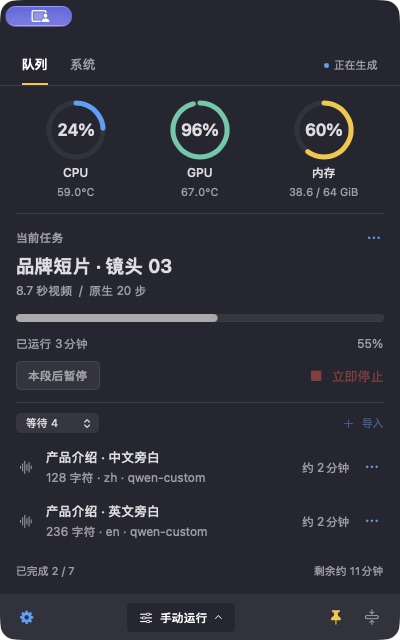
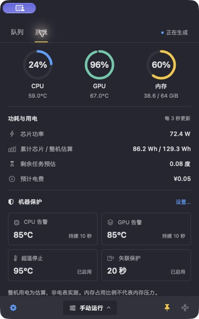

# IdleDock · macOS 本地算力队列

**给本地 AI 任务排好队，让 Mac 趁空干活。**

[English](README.md) · [安装](docs/INSTALL.md) · [Agent 使用指南](docs/AGENT_GUIDE.md) · [Provider 接入](docs/PROVIDERS.md)

把 H3 视频、批量 TTS 配音和其他本地计算任务放进同一个串行队列，通过菜单栏、悬浮挂件或 JSON CLI 管理。IdleDock 原名 **Queue Mac H3**，曾以 Local Compute Queue 描述。为兼容已有安装，继续保留 `H3 Queue.app` 文件名、内部标识和 `H3_QUEUE_*` 配置名称，应用显示名为 IdleDock。

## 界面截图

| H3 / TTS 混合任务队列 | 系统监控与机器保护 |
| --- | --- |
|  |  |

截图来自已实现的原生应用只读预览。任务名称、进度和监测数值均为演示数据，预览中的队列控制已禁用。[演示数据与截图说明](docs/images/README.md)。

## 能做什么

- 所有 provider 共用队列与协作锁，同一时间只执行一项任务。
- 手动、每日时段、智能空闲三种运行方式；入队和保存配置不改变运行模式。
- SQLite 保存任务、每次执行记录、缓存指纹与实测数据，媒体文件单独存放。
- 温度、内存、交换内存、磁盘和超时保护；保护停止后需要明确恢复。
- 批量原子导入、重试、取消、优先级、视频预览与音频试听。
- 原生 SwiftUI/AppKit 界面，支持简体中文、繁体中文、英文、日文、韩文、西班牙文、法文、德文、俄文、葡萄牙语（巴西）和意大利语，默认跟随系统，可即时切换。无需 Web 服务、云账户、Docker、Redis 或 npm。

队列本身使用 Python 标准库及 `psutil`，模型在各自环境中运行。

## 开源范围

| 接入方式 | 仓库包含 | 使用者需要准备 |
| --- | --- | --- |
| 通用命令 provider | JSON/argv 协议、可运行的轻量 CPU 示例 | 已安装的本地程序 |
| TTS | 多 profile 队列及四类运行时适配器 | 兼容运行时、本地模型、配置文件 |
| H3 | 文生视频、原生音频驱动适配器 | 原部署包装器和入口；音频驱动还需匹配的补丁引擎 |

**本项目不附带模型权重、模型环境或原 H3 部署。** 克隆仓库不等于已装好 H3/TTS。请先看[部署契约](docs/DEPLOYMENT.md)；没有既有模型也可以用示例 provider 验证队列。

当前所有任务串行，包括 CPU provider；共享锁不能约束绕过协议启动的外部程序。暂未提供自动 TTS → H3 依赖编排、模型下载或常驻模型池。测试通过表示队列与适配协议通过验证，不表示所有 TTS 模型都经过真实合成、音质或口型验收。

## 快速开始

要求 Apple Silicon、macOS 14+、Python 3.10+；编译原生应用需要 Command Line Tools。在仓库目录执行：

```sh
git clone https://github.com/RockHammer1947/IdleDock.git
cd IdleDock
python3 -m venv .venv
.venv/bin/python -m pip install -r requirements.txt
export H3_QUEUE_PYTHON="$PWD/.venv/bin/python"
./queue --help
.venv/bin/python -m unittest discover -s tests -p 'test_providers.py' -v
```

测试使用临时数据库、假模型和短音频，不下载或启动真实模型。接下来按[安装文档中的隔离示例](docs/INSTALL.md#isolated-demo)导入第一项任务。正常执行队列还需要有效温度监测，视频处理需要 FFmpeg/ffprobe。

已有部署的用户可以配置后安装界面：

```sh
./queue configure --deployment /absolute/local-model-deployment
./queue doctor
./setup.command
```

安装脚本构建本地签名应用并启动后台 worker；新队列默认暂停，已有队列保留当前模式。应用绑定当前源码和 Python 路径，尚不是可直接转发的公证安装包。

## 日常使用

在 **齿轮设置 → 语言 / Language** 中选择「跟随系统」或11 种界面语言之一。语言名称以各自语言显示，选择会自动保存，不改变队列运行方式，也不会改变 TTS 合成语言。[多语言说明](docs/LOCALIZATION.md)。

```sh
./queue providers
./queue enqueue /absolute/request.json --title '项目 · 镜头01'
./queue enqueue-batch /absolute/batch.json
./queue status
```

入队不启用运行，但队列原本已启用时，新任务可能自动执行。明确要开始计算时使用 `start`、`auto` 或 `smart`。`pause` 完成本项后暂停；`stop` 请求立即停止，并重新排队未完成任务。关闭界面不会停止后台计算。详见[操作与故障恢复](docs/USAGE.md)。

## 文档和 Agent 入口

统一规则放在 [AGENTS.md](AGENTS.md)，Claude Code 通过 [CLAUDE.md](CLAUDE.md) 导入，WorkBuddy/CodeBuddy 通过 [CODEBUDDY.md](CODEBUDDY.md) 进入。[Agent 指南](docs/AGENT_GUIDE.md)提供首次使用提示词、命令边界、状态读取和扩展步骤。

- [安装与排障](docs/INSTALL.md)、[部署契约](docs/DEPLOYMENT.md)、[Provider 接入](docs/PROVIDERS.md)
- [架构](docs/ARCHITECTURE.md)、[交互设计](docs/INTERACTION_DESIGN.md)
- [开发贡献](CONTRIBUTING.md)、[安全说明](SECURITY.md)、[发布清单](docs/RELEASING.md)

代码与文档采用 [MIT](LICENSE)。外部运行时、模型和用户素材遵循各自许可，不随本仓库重新授权；见[第三方依赖说明](THIRD_PARTY.md)。
