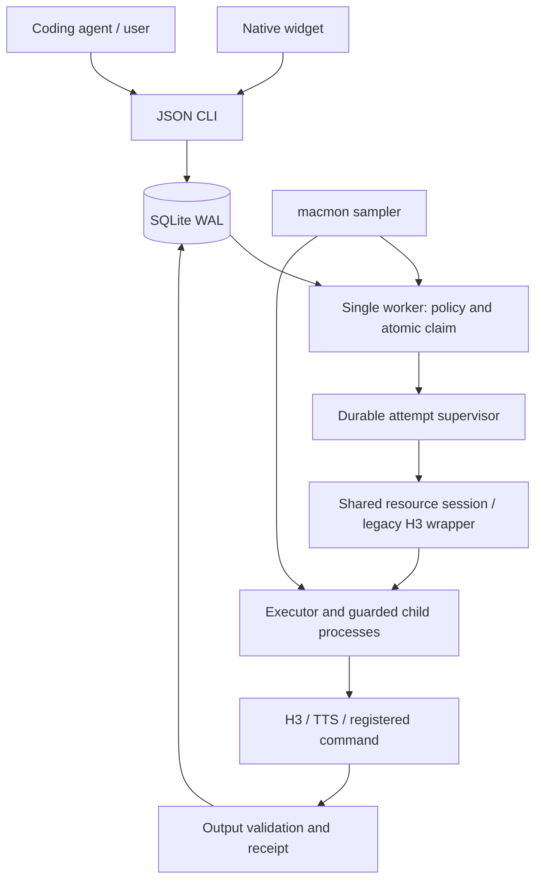

# Architecture

The CLI/UI submit data. Normalization snapshots a provider's configuration, declared dependencies, and assets; the fingerprint controls deduplication/cache reuse. SQLite claims jobs transactionally in descending priority, then creation time. A worker file lock prevents duplicate workers for one state directory; the deployment lock coordinates model sessions across participating tools.

A **job** is a fixed request. An **attempt** is one execution with its own directory, logs, request, process ownership record, and receipt. The independent supervisor outlives the UI/worker, lets the session restore the resident service, and checks owned process cleanup. Reconnecting a worker checks the unique request path before deciding an attempt is stale. Failures do not trigger unlimited retries.

Providers implement `normalize`, `resources`, `describe`, and `run`. Command manifests expose a simpler subprocess protocol. The executor owns validated artifacts, while the session owns the lock and resident-service lifecycle. Provider output kinds are `audio`, `video`, `json`, and `file`. Validation is technical; human acceptance stays separate.

The first generalized version deliberately keeps **one active job**, regardless of CPU/GPU declarations. Resource requirements provide admission metadata and a future extension point; they do not allocate GPU percentages or reserve OS memory. No automatic dependency DAG or persistent model pool exists yet.

Safety runs both in the worker and the independent executor so a UI/worker outage does not disable protection. Sensor history is bounded; stale readings remain unknown. A safety trip pauses the queue and records its reason. Estimates use successful samples from the same machine/configuration; energy estimates are whole-machine/chip observations, not a model-specific meter.

Storage version 4 adds provider metrics while preserving legacy H3 specs, fingerprints, settings, attempts, and cache. Omitted `provider` means H3. The app name/path, bundle identifier, launch-agent label, and environment-variable names retain legacy identifiers to avoid creating a second installation accidentally.

See [AGENTS.md](../AGENTS.md) for the code map, [PROVIDERS.md](PROVIDERS.md) for adapter behavior, and [DEPLOYMENT.md](DEPLOYMENT.md) for the external runtime boundary.
